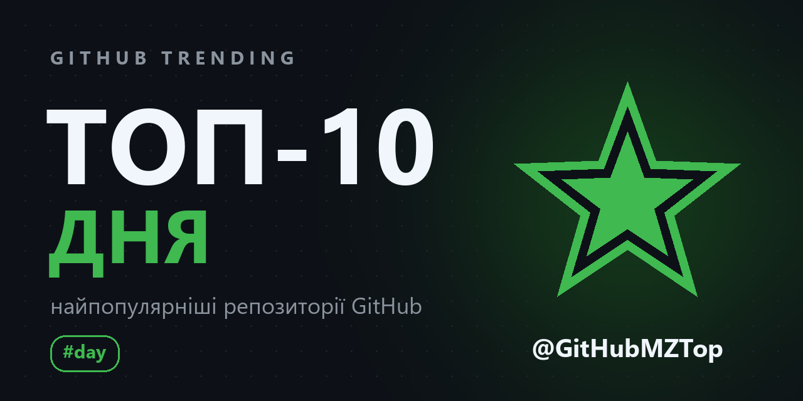
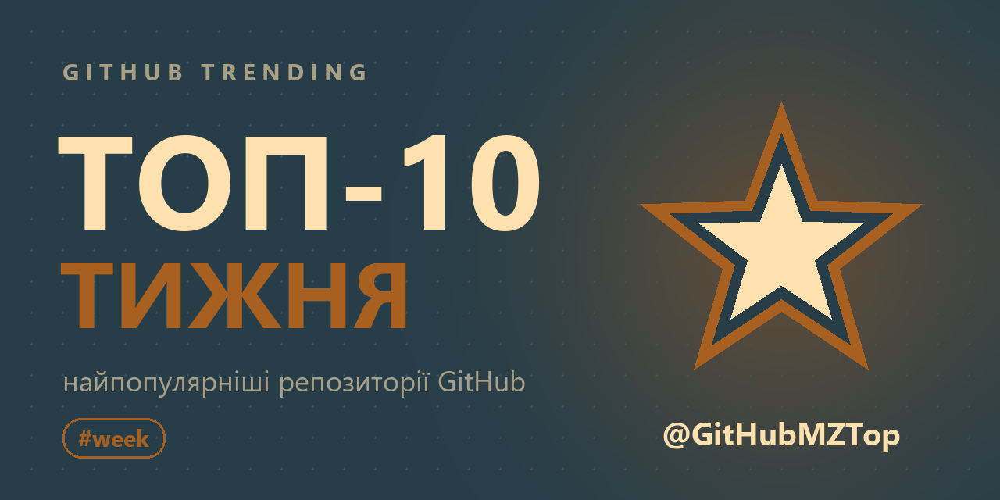
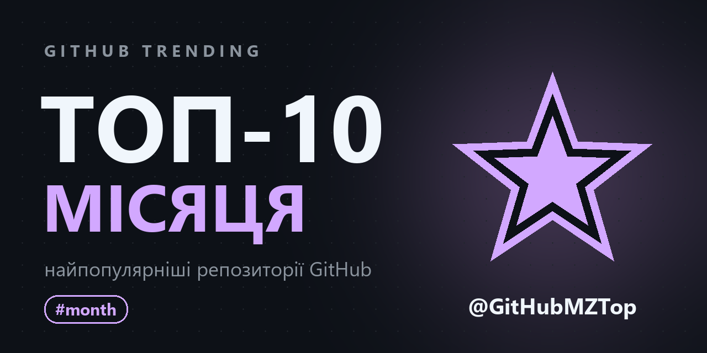
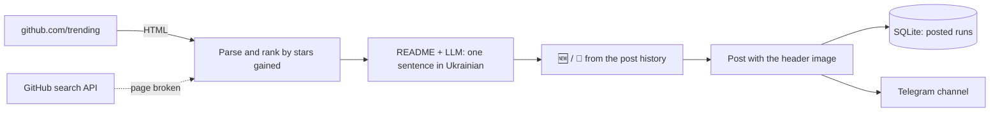

<p align="center">
  <b>🇬🇧 English</b> | <a href="README.uk.md">🇺🇦 Українська</a> | <a href="README.pl.md">🇵🇱 Polski</a>
</p>

<div align="center">
  <h1>🔥 GitHub Parser</h1>
  <p>A Telegram bot that posts the top-10 trending GitHub repositories of the day, the week and the month to a channel, with a one-line description of each in Ukrainian.</p>
</div>

<p align="center">
  <a href="https://github.com/dmytrokurochkin/GitHub-Parser/actions/workflows/tests.yml">
    
  </a>
  
  
  
  <a href="LICENSE"></a>
</p>

<p align="center">
  <a href="https://t.me/GitHubMZTop">
    
  </a>
</p>

## 📖 About the project

**GitHub Parser** runs the Telegram channel [@GitHubMZTop](https://t.me/GitHubMZTop). Every morning it takes [github.com/trending](https://github.com/trending), ranks the repositories by the stars they gained, has an LLM explain in one Ukrainian sentence what each project is and why it matters, and publishes a neat top-10 with a header image. On Sundays a weekly top comes out as well, and on the 1st of the month a monthly one.

The bot is built to run unattended on a small home server (an old laptop with Debian is enough): it never posts the same top twice, catches up on a post missed while the server was off, and writes to its owner when something goes wrong. It answers no one but the owner.

---

## ✨ Key features

- 📅 **Three regular tops**: day (every day), week (Sundays) and month (the 1st), at 06:00 Europe/Warsaw, tagged `#day`, `#week`, `#month`.
- 📈 **Ranked by stars gained**: the post shows `+N` stars for the period next to the total, and the ranks follow that number.
- 🇺🇦 **Descriptions in Ukrainian**: an LLM (OpenAI-compatible API) reads the GitHub description and the start of the README and writes one clear sentence. Descriptions are cached, and without an API key the original description is used.
- 🆕 **Marks for newcomers and regulars**: 🆕 for a repository that enters the top for the first time, `🔁 3rd day in a row` for one that stays.
- 🖼️ **Header image** for each period, shown above the post as a large preview, with the channel name on it.
- 🛡️ **Duplicate-safe**: a post interrupted by a timeout is never resent automatically, a refusal by Telegram is retried, a restart picks up where it stopped.
- ⏰ **Catch-up**: if the server was off at 06:00, the post goes out after start-up (up to 12 hours late by default).
- 🔁 **Fallback source**: if the trending page changes its layout, the top is built from the GitHub search API and the owner is warned.
- 🔒 **Owner only**: commands are accepted from one Telegram ID, everyone else gets no answer.
- 🐳 **One-command deployment**: Docker Compose and `deploy.sh`, which also keeps a laptop from falling asleep.

---

## 🖼️ Demo

| Top of the day | Top of the week | Top of the month |
| :---: | :---: | :---: |
|  |  |  |

An example of a post (the posts in the channel are in Ukrainian):

```text
🔥 Топ-10 репозиторіїв GitHub за день
📅 30.10.2026

1. pbakaus/impeccable 🆕
⭐ 96.9k · +2 299 за день · Rust
Набір команд, що вчить AI-агентів робити охайний дизайн інтерфейсів.

2. HKUDS/DeepTutor 🔁 2-й день поспіль
⭐ 51.7k · +2 282 за день · Python
Персональний AI-репетитор, що підлаштовується під того, хто навчається.

...

📢 @GitHubMZTop
#day
```

---

## ⚙️ How it works



Every 30 seconds the scheduler checks whether a post of the day, the week or the month is due. A post is claimed in SQLite before it is sent, so a restart or a second command cannot publish it twice. See [CLAUDE.md](CLAUDE.md) for the architecture and the pitfalls already met.

---

## 🤖 Commands (owner only)

| Command | What it does |
|---|---|
| `/status` | the last post of each period, errors and the time of the next ones |
| `/preview day\|week\|month` | build a post and send it to you, nothing goes to the channel |
| `/test` | build all three posts and send them to you, nothing goes to the channel |
| `/post day\|week\|month` | publish to the channel right now |
| `/pause` / `/resume` | stop / resume the schedule |

---

## 🛠 Tech stack

- **Bot**: Python 3.12, [aiogram 3](https://docs.aiogram.dev/en/latest/), aiohttp
- **Trending data**: github.com/trending parsed with BeautifulSoup, GitHub REST API (search, README)
- **Descriptions**: OpenAI SDK against an OpenAI-compatible provider (Lapathonia, MamayLM by default)
- **Storage**: SQLite via `aiosqlite`
- **Images**: Pillow (`assets/make_banners.py`)
- **Infrastructure**: Docker Compose, `deploy.sh`, GitHub Actions

---

## 🚀 Server deployment (Debian)

### 1. Prepare

1. Create a bot with [@BotFather](https://t.me/BotFather) and keep its token.
2. Create a channel and add the bot as an administrator with the right to post messages.
3. Find your Telegram ID with [@userinfobot](https://t.me/userinfobot) and press `/start` in your bot, otherwise it cannot write to you.
4. Recommended: a [GitHub token](https://github.com/settings/personal-access-tokens/new) with no permissions, access "Public repositories". It raises the GitHub limit from 60 to 5000 requests an hour.
5. Optional: an API key of the LLM provider for the Ukrainian descriptions.

### 2. Run

```bash
git clone https://github.com/dmytrokurochkin/GitHub-Parser.git
cd GitHub-Parser
./deploy.sh
```

`deploy.sh` installs Docker if needed, asks for the tokens and IDs and writes them to `.env` (mode 600), offers to disable sleep on a laptop (including the lid switch), turns on clock sync and starts the container with automatic restart. Once started, the bot sends you the time of the next posts.

| Action | Command |
|---|---|
| Update to the latest version | `./deploy.sh` |
| Change tokens and IDs | `./deploy.sh --reconfigure` |
| Logs | `docker compose logs -f` |
| Stop | `docker compose down` |

### 3. Configuration

Everything lives in `.env`, each variable is explained in [.env.example](.env.example). The main ones:

| Variable | Default | Meaning |
|---|---|---|
| `BOT_TOKEN`, `CHANNEL_ID`, `ADMIN_ID` | required | the bot, the channel, the only person it answers |
| `GITHUB_TOKEN` | empty | 5000 GitHub requests an hour instead of 60 |
| `LAPATHONIA_API_KEY`, `LLM_MODEL` | empty, MamayLM | Ukrainian descriptions; empty key means original descriptions |
| `TIMEZONE`, `POST_TIME` | `Europe/Warsaw`, `06:00` | when the posts go out |
| `WEEKLY_DAY`, `MONTHLY_DAY` | `sunday`, `1` | the day of the weekly and the monthly top |
| `CATCH_UP_HOURS` | `12` | how late a missed post may still go out |
| `TOP_SIZE` | `10` | repositories in a top (1-25) |

After changing `.env` run `docker compose up -d`.

---

## 💻 Local development

```bash
python -m venv .venv
.venv/bin/pip install -r requirements-dev.txt   # Windows: .venv\Scripts\pip
cp .env.example .env                             # fill it in
.venv/bin/python main.py
.venv/bin/python -m pytest
```

The tests run on saved copies of the trending page, so a change of GitHub's layout shows up as a failing test. To redraw the header images: `python assets/make_banners.py` (`--channel @name` for another channel), then bump `IMAGES_VERSION` in `services/digest.py`, because Telegram caches link previews by URL.

---

## ⚠️ Disclaimer

This project is not affiliated with, endorsed or sponsored by GitHub. It reads the public trending page and the public GitHub API in small volumes (a few requests per post) and links back to every repository it mentions. The descriptions are written by a language model and may be inaccurate; the repository itself is always the source of truth.

---

## 📄 License

[AGPL-3.0](LICENSE). Issues and pull requests are welcome.
