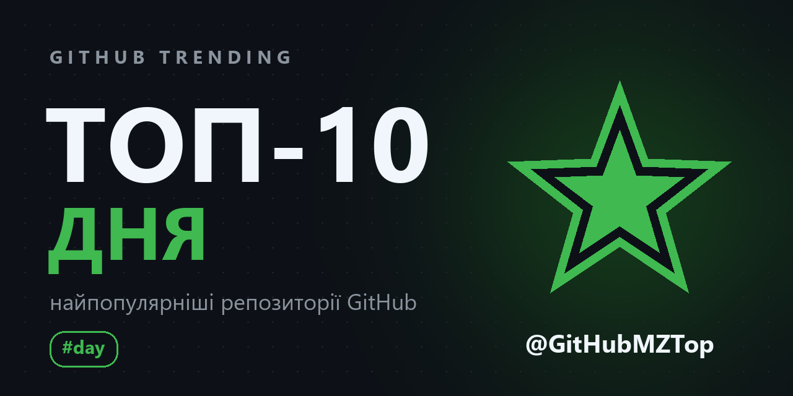
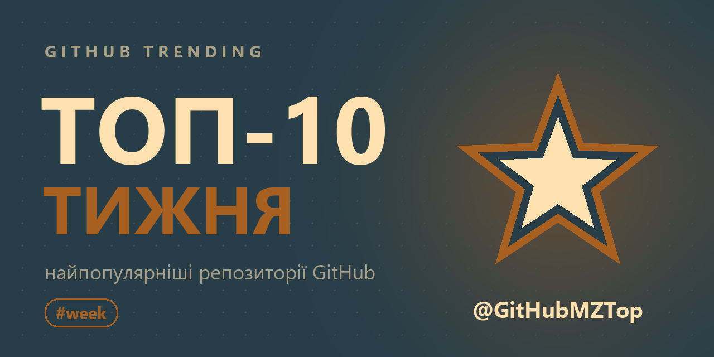
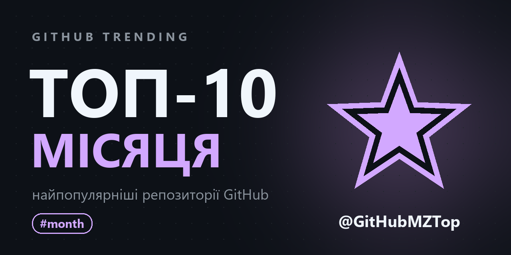
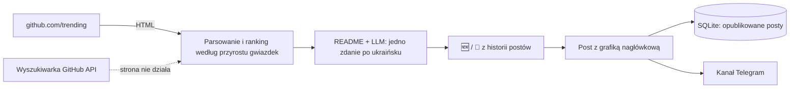

<p align="center">
  <a href="README.md">🇬🇧 English</a> | <a href="README.uk.md">🇺🇦 Українська</a> | <b>🇵🇱 Polski</b>
</p>

<div align="center">
  <h1>🔥 GitHub Parser</h1>
  <p>Bot Telegram, który publikuje na kanale top-10 popularnych repozytoriów GitHub z dnia, tygodnia i miesiąca, z krótkim opisem każdego po ukraińsku.</p>
</div>

<p align="center">
  <a href="https://github.com/dmytrokurochkin/GitHub-Parser/actions/workflows/tests.yml">
    
  </a>
  
  
  
  <a href="LICENSE"></a>
</p>

<p align="center">
  <a href="https://t.me/GitHubMZTop">
    
  </a>
</p>

## 📖 O projekcie

**GitHub Parser** prowadzi kanał Telegram [@GitHubMZTop](https://t.me/GitHubMZTop). Każdego ranka pobiera [github.com/trending](https://github.com/trending), układa repozytoria według liczby zdobytych gwiazdek, prosi model językowy (LLM) o wyjaśnienie jednym zdaniem po ukraińsku, czym jest projekt i do czego służy, a następnie publikuje schludny top-10 z grafiką nagłówkową. W niedzielę ukazuje się także top tygodnia, a pierwszego dnia miesiąca top miesiąca.

Bot jest przystosowany do pracy bez nadzoru na małym domowym serwerze (wystarczy stary laptop z Debianem): ten sam top nigdy nie zostanie opublikowany dwa razy, post pominięty przez wyłączony serwer ukaże się po uruchomieniu, a o problemach bot informuje właściciela. Nie odpowiada nikomu poza właścicielem.

---

## ✨ Główne funkcje

- 📅 **Trzy stałe zestawienia**: dzień (codziennie), tydzień (w niedzielę) i miesiąc (1. dnia), o 06:00 czasu warszawskiego, z hashtagami `#day`, `#week`, `#month`.
- 📈 **Ranking według przyrostu gwiazdek**: obok łącznej liczby post pokazuje `+N` gwiazdek za okres, a miejsca w topie wynikają właśnie z tej liczby.
- 🇺🇦 **Opisy po ukraińsku**: LLM (API zgodne z OpenAI) czyta opis i początek README i pisze jedno zrozumiałe zdanie. Opisy są zapisywane w pamięci podręcznej, a bez klucza API zostaje oryginalny opis.
- 🆕 **Oznaczenia nowych i stałych bywalców**: 🆕 dla repozytorium, które pierwszy raz trafia do topu, `🔁 3. dzień z rzędu` dla tego, które się w nim utrzymuje.
- 🖼️ **Grafika nagłówkowa** dla każdego okresu, wyświetlana nad postem jako duży podgląd, z nazwą kanału.
- 🛡️ **Bez duplikatów**: post przerwany przez przekroczenie czasu nigdy nie jest wysyłany ponownie automatycznie, odmowa Telegrama jest ponawiana, a po restarcie bot kontynuuje tam, gdzie skończył.
- ⏰ **Nadrabianie**: jeśli o 06:00 serwer był wyłączony, post ukaże się po uruchomieniu (domyślnie do 12 godzin opóźnienia).
- 🔁 **Zapasowe źródło**: jeśli strona trending zmieni układ, top jest budowany z wyszukiwarki API GitHub, a właściciel dostaje ostrzeżenie.
- 🔒 **Tylko dla właściciela**: polecenia są przyjmowane od jednego Telegram ID, pozostali nie dostają odpowiedzi.
- 🐳 **Wdrożenie jednym poleceniem**: Docker Compose i `deploy.sh`, który dodatkowo nie pozwala laptopowi zasnąć.

---

## 🖼️ Demo

| Top dnia | Top tygodnia | Top miesiąca |
| :---: | :---: | :---: |
|  |  |  |

Przykładowy post (posty na kanale są po ukraińsku):

```text
🔥 Топ-10 репозиторіїв GitHub за день
📅 30.10.2026

1. pbakaus/impeccable 🆕
⭐ 96.9k · +2 299 за день · Rust
Набір команд, що вчить AI-агентів робити охайний дизайн інтерфейсів.

2. HKUDS/DeepTutor 🔁 2-й день поспіль
⭐ 51.7k · +2 282 за день · Python
Персональний AI-репетитор, що підлаштовується під того, хто навчається.

...

📢 @GitHubMZTop
#day
```

---

## ⚙️ Jak to działa



Co 30 sekund harmonogram sprawdza, czy nadszedł czas na post dnia, tygodnia lub miesiąca. Post jest oznaczany w SQLite przed wysłaniem, więc ani restart, ani drugie polecenie nie opublikują go dwa razy. Architektura i znane pułapki są opisane w [CLAUDE.md](CLAUDE.md) (po ukraińsku).

---

## 🤖 Polecenia (tylko dla właściciela)

| Polecenie | Co robi |
|---|---|
| `/status` | ostatni post każdego zestawienia, błędy i godzina następnych |
| `/preview day\|week\|month` | zbiera post i wysyła go tobie, na kanał nic nie trafia |
| `/test` | zbiera wszystkie trzy posty i wysyła je tobie, na kanał nic nie trafia |
| `/post day\|week\|month` | publikuje na kanale od razu |
| `/pause` / `/resume` | wstrzymuje / wznawia harmonogram |

---

## 🛠 Stos technologiczny

- **Bot**: Python 3.12, [aiogram 3](https://docs.aiogram.dev/en/latest/), aiohttp
- **Dane o trendach**: parsowanie github.com/trending przez BeautifulSoup, GitHub REST API (wyszukiwanie, README)
- **Opisy**: OpenAI SDK z dostawcą zgodnym z OpenAI (Lapathonia, domyślnie MamayLM)
- **Przechowywanie danych**: SQLite przez `aiosqlite`
- **Grafika**: Pillow (`assets/make_banners.py`)
- **Infrastruktura**: Docker Compose, `deploy.sh`, GitHub Actions

---

## 🚀 Wdrożenie na serwerze (Debian)

### 1. Przygotowanie

1. Utwórz bota w [@BotFather](https://t.me/BotFather) i zachowaj token.
2. Utwórz kanał i dodaj bota jako administratora z prawem publikowania wiadomości.
3. Sprawdź swój Telegram ID w [@userinfobot](https://t.me/userinfobot) i naciśnij `/start` w swoim bocie, inaczej nie będzie mógł do ciebie pisać.
4. Zalecane: [token GitHub](https://github.com/settings/personal-access-tokens/new) bez żadnych uprawnień, dostęp „Public repositories”. Limit GitHub wzrośnie z 60 do 5000 zapytań na godzinę.
5. Opcjonalnie: klucz API dostawcy LLM do opisów po ukraińsku.

### 2. Uruchomienie

```bash
git clone https://github.com/dmytrokurochkin/GitHub-Parser.git
cd GitHub-Parser
./deploy.sh
```

`deploy.sh` zainstaluje Dockera, jeśli go nie ma, zapyta o tokeny i ID i zapisze je w `.env` (uprawnienia 600), zaproponuje wyłączenie usypiania laptopa (także po zamknięciu klapy), włączy synchronizację zegara i uruchomi kontener z automatycznym restartem. Po starcie bot wyśle ci godziny następnych postów.

| Czynność | Polecenie |
|---|---|
| Aktualizacja do najnowszej wersji | `./deploy.sh` |
| Zmiana tokenów i ID | `./deploy.sh --reconfigure` |
| Logi | `docker compose logs -f` |
| Zatrzymanie | `docker compose down` |

### 3. Konfiguracja

Wszystko znajduje się w `.env`, każda zmienna jest opisana w [.env.example](.env.example) (po ukraińsku). Najważniejsze:

| Zmienna | Domyślnie | Znaczenie |
|---|---|---|
| `BOT_TOKEN`, `CHANNEL_ID`, `ADMIN_ID` | wymagane | bot, kanał, jedyna osoba, której bot odpowiada |
| `GITHUB_TOKEN` | puste | 5000 zapytań do GitHub na godzinę zamiast 60 |
| `LAPATHONIA_API_KEY`, `LLM_MODEL` | puste, MamayLM | opisy po ukraińsku; bez klucza oryginalne opisy |
| `TIMEZONE`, `POST_TIME` | `Europe/Warsaw`, `06:00` | kiedy ukazują się posty |
| `WEEKLY_DAY`, `MONTHLY_DAY` | `sunday`, `1` | dzień topu tygodnia i topu miesiąca |
| `CATCH_UP_HOURS` | `12` | jak późno pominięty post może się jeszcze ukazać |
| `TOP_SIZE` | `10` | liczba repozytoriów w topie (1-25) |

Po zmianie `.env` uruchom `docker compose up -d`.

---

## 💻 Rozwój lokalny

```bash
python -m venv .venv
.venv/bin/pip install -r requirements-dev.txt   # Windows: .venv\Scripts\pip
cp .env.example .env                             # uzupełnij
.venv/bin/python main.py
.venv/bin/python -m pytest
```

Testy działają na zapisanych kopiach strony trending, więc zmiana układu GitHub od razu ujawni się jako nieudany test. Aby przerysować grafiki nagłówkowe: `python assets/make_banners.py` (`--channel @name` dla innego kanału), a następnie zwiększ `IMAGES_VERSION` w `services/digest.py`, bo Telegram zapisuje podglądy linków w pamięci podręcznej według adresu.

---

## ⚠️ Zastrzeżenie

Projekt nie jest powiązany z GitHub ani przez niego wspierany. Czyta publiczną stronę trendów i publiczne API GitHub w niewielkiej skali (kilka zapytań na post) i w każdym poście linkuje do wymienionych repozytoriów. Opisy pisze model językowy, więc mogą być niedokładne; źródłem prawdy zawsze jest samo repozytorium.

---

## 📄 Licencja

[AGPL-3.0](LICENSE). Zgłoszenia (issues) i pull requesty są mile widziane.
