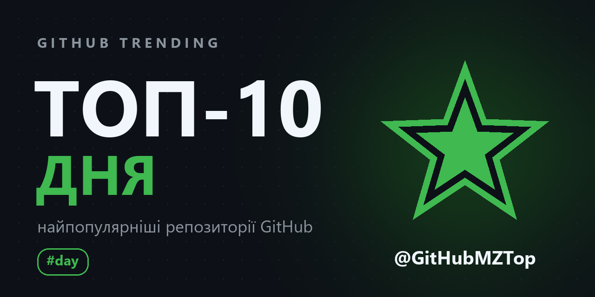
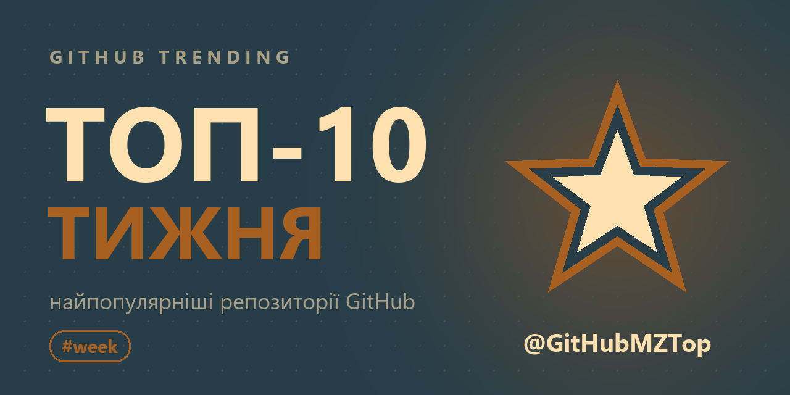
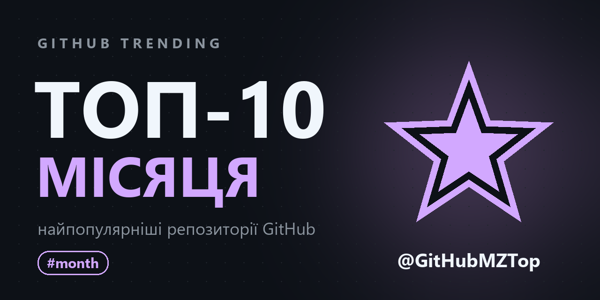
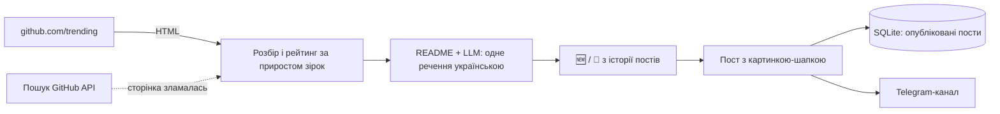

<p align="center">
  <a href="README.md">🇬🇧 English</a> | <b>🇺🇦 Українська</b> | <a href="README.pl.md">🇵🇱 Polski</a>
</p>

<div align="center">
  <h1>🔥 GitHub Parser</h1>
  <p>Telegram-бот, який публікує в канал топ-10 трендових репозиторіїв GitHub за день, тиждень і місяць, з коротким описом кожного українською.</p>
</div>

<p align="center">
  <a href="https://github.com/dmytrokurochkin/GitHub-Parser/actions/workflows/tests.yml">
    
  </a>
  
  
  
  <a href="LICENSE"></a>
</p>

<p align="center">
  <a href="https://t.me/GitHubMZTop">
    
  </a>
</p>

## 📖 Про проєкт

**GitHub Parser** веде Telegram-канал [@GitHubMZTop](https://t.me/GitHubMZTop). Щоранку він бере [github.com/trending](https://github.com/trending), ранжує репозиторії за кількістю отриманих зірок, просить LLM пояснити одним реченням українською, що це за проєкт і навіщо він, і публікує акуратний топ-10 з картинкою-шапкою. У неділю виходить ще й тижневий топ, а 1-го числа місячний.

Бот розрахований на роботу без нагляду на маленькому домашньому сервері (вистачить старого ноутбука з Debian): той самий топ ніколи не виходить двічі, пост, пропущений через вимкнений сервер, виходить після запуску, а про проблеми бот пише власнику. Нікому, крім власника, він не відповідає.

---

## ✨ Основні можливості

- 📅 **Три регулярні рубрики**: день (щодня), тиждень (у неділю) і місяць (1-го числа), о 06:00 за Варшавою, з хештегами `#day`, `#week`, `#month`.
- 📈 **Рейтинг за приростом зірок**: біля загальної кількості в пості стоїть `+N` за період, і місця в топі йдуть саме за цим числом.
- 🇺🇦 **Описи українською**: LLM (OpenAI-сумісний API) читає опис і початок README та пише одне зрозуміле речення. Описи кешуються, а без ключа API лишається оригінальний опис.
- 🆕 **Позначки новачків і завсідників**: 🆕 для того, хто вперше в топі, `🔁 3-й день поспіль` для того, хто тримається.
- 🖼️ **Картинка-шапка** для кожного періоду: велике прев'ю над постом з назвою каналу.
- 🛡️ **Без дублів**: пост, обірваний тайм-аутом, ніколи не надсилається повторно сам; відмова Telegram повторюється; після перезапуску бот продовжує з того місця, де зупинився.
- ⏰ **Догонка**: якщо о 06:00 сервер був вимкнений, пост вийде після запуску (типово до 12 годин запізнення).
- 🔁 **Запасне джерело**: якщо сторінка trending змінить верстку, топ збирається з пошуку GitHub, а власник отримує попередження.
- 🔒 **Лише для власника**: команди приймаються від одного Telegram ID, решта не отримує відповіді.
- 🐳 **Розгортання однією командою**: Docker Compose і `deploy.sh`, який ще й не дає ноутбуку заснути.

---

## 🖼️ Демо

| Топ дня | Топ тижня | Топ місяця |
| :---: | :---: | :---: |
|  |  |  |

Приклад посту:

```text
🔥 Топ-10 репозиторіїв GitHub за день
📅 30.10.2026

1. pbakaus/impeccable 🆕
⭐ 96.9k · +2 299 за день · Rust
Набір команд, що вчить AI-агентів робити охайний дизайн інтерфейсів.

2. HKUDS/DeepTutor 🔁 2-й день поспіль
⭐ 51.7k · +2 282 за день · Python
Персональний AI-репетитор, що підлаштовується під того, хто навчається.

...

📢 @GitHubMZTop
#day
```

---

## ⚙️ Як це працює



Кожні 30 секунд розклад перевіряє, чи настав час посту дня, тижня або місяця. Пост позначається в SQLite до надсилання, тому ні перезапуск, ні друга команда не опублікують його двічі. Архітектура й підводні камені описані в [CLAUDE.md](CLAUDE.md).

---

## 🤖 Команди (лише для власника)

| Команда | Що робить |
|---|---|
| `/status` | останній пост кожної рубрики, помилки і час наступних |
| `/preview day\|week\|month` | зібрати пост і надіслати тобі, у канал нічого не йде |
| `/test` | зібрати всі три пости і надіслати тобі, у канал нічого не йде |
| `/post day\|week\|month` | опублікувати в канал зараз |
| `/pause` / `/resume` | зупинити / відновити розклад |

---

## 🛠 Стек

- **Бот**: Python 3.12, [aiogram 3](https://docs.aiogram.dev/en/latest/), aiohttp
- **Тренди**: розбір github.com/trending через BeautifulSoup, GitHub REST API (пошук, README)
- **Описи**: OpenAI SDK з OpenAI-сумісним провайдером (Lapathonia, типово MamayLM)
- **Сховище**: SQLite через `aiosqlite`
- **Картинки**: Pillow (`assets/make_banners.py`)
- **Інфраструктура**: Docker Compose, `deploy.sh`, GitHub Actions

---

## 🚀 Розгортання на сервері (Debian)

### 1. Підготовка

1. Створи бота в [@BotFather](https://t.me/BotFather) і збережи токен.
2. Створи канал і додай бота адміністратором з правом «Публікація повідомлень».
3. Дізнайся свій Telegram ID в [@userinfobot](https://t.me/userinfobot) і натисни `/start` у своєму боті, інакше він не зможе тобі писати.
4. Бажано: [GitHub-токен](https://github.com/settings/personal-access-tokens/new) без жодних прав, доступ «Public repositories». Ліміт GitHub стане 5000 запитів на годину замість 60.
5. Необов'язково: ключ API LLM-провайдера для описів українською.

### 2. Запуск

```bash
git clone https://github.com/dmytrokurochkin/GitHub-Parser.git
cd GitHub-Parser
./deploy.sh
```

`deploy.sh` встановить Docker, якщо його немає, запитає токени та ID і запише їх у `.env` (права 600), запропонує вимкнути сон ноутбука (зокрема при закритій кришці), увімкне синхронізацію годинника і запустить контейнер з автоперезапуском. Після старту бот надішле тобі час наступних постів.

| Дія | Команда |
|---|---|
| Оновити до нової версії | `./deploy.sh` |
| Змінити токени й ID | `./deploy.sh --reconfigure` |
| Логи | `docker compose logs -f` |
| Зупинити | `docker compose down` |

### 3. Налаштування

Усе лежить у `.env`, кожна змінна пояснена в [.env.example](.env.example). Основні:

| Змінна | Типово | Що це |
|---|---|---|
| `BOT_TOKEN`, `CHANNEL_ID`, `ADMIN_ID` | обов'язкові | бот, канал, єдиний, кому бот відповідає |
| `GITHUB_TOKEN` | порожньо | 5000 запитів до GitHub на годину замість 60 |
| `LAPATHONIA_API_KEY`, `LLM_MODEL` | порожньо, MamayLM | описи українською; без ключа оригінальні описи |
| `TIMEZONE`, `POST_TIME` | `Europe/Warsaw`, `06:00` | коли виходять пости |
| `WEEKLY_DAY`, `MONTHLY_DAY` | `sunday`, `1` | день тижневого і місячного топу |
| `CATCH_UP_HOURS` | `12` | наскільки пізно ще може вийти пропущений пост |
| `TOP_SIZE` | `10` | скільки репозиторіїв у топі (1-25) |

Після зміни `.env` виконай `docker compose up -d`.

---

## 💻 Локальна розробка

```bash
python -m venv .venv
.venv/bin/pip install -r requirements-dev.txt   # Windows: .venv\Scripts\pip
cp .env.example .env                             # заповнити
.venv/bin/python main.py
.venv/bin/python -m pytest
```

Тести працюють на збережених копіях сторінки trending, тож зміна верстки GitHub одразу покаже себе тестом, що падає. Перемалювати шапки: `python assets/make_banners.py` (`--channel @name` для іншого каналу), потім збільшити `IMAGES_VERSION` у `services/digest.py`, бо Telegram кешує прев'ю за адресою.

---

## ⚠️ Застереження

Проєкт не пов'язаний з GitHub і не схвалений ним. Він читає публічну сторінку трендів і публічний GitHub API в невеликих обсягах (кілька запитів на пост) і в кожному пості посилається на згадані репозиторії. Описи пише мовна модель, тож вони можуть бути неточними; першоджерело завжди сам репозиторій.

---

## 📄 Ліцензія

[AGPL-3.0](LICENSE). Issues і pull requests вітаються.
